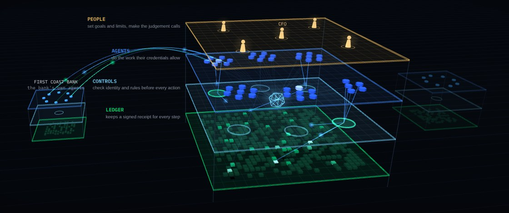

<p align="center">
  <a href="https://ae-os.org">
    <picture>
      <source media="(prefers-color-scheme: dark)" srcset="assets/logo-dark.png">
      
    </picture>
  </a>
</p>

<p align="center"><strong>The Agent-Native Enterprise Operating System</strong></p>

<p align="center">
  <a href="https://ae-os.org">Website</a> ·
  <a href="https://ae-os.org/#film">Film</a> ·
  <a href="https://ae-os.org/#architecture">Architecture</a> ·
  <a href="https://ae-os.org/#research">Research paper</a>
</p>

<a href="https://ae-os.org"></a>

AE-OS is an early-stage open-source framework and research project by Darren Lentz. It studies how an organization's core systems could be run by software agents working under human authority, with a signed receipt for every action that an auditor can check independently.

The image above is a frame from the film on [ae-os.org](https://ae-os.org), which follows one simulated quarter-end close at a fictional company. The site also has the research paper and an interactive map of the architecture.

## What is here

| Path | What it is |
|---|---|
| [`spec/receipts-v0.md`](spec/receipts-v0.md) | AE-OS Receipts format: records, Merkle log, signed checkpoints, receipts and consistency proofs |
| [`python/`](python/) | `aeos-receipts`, the Python library and command line, including an MCP proxy that records an agent's tool calls |
| [`rust/`](rust/) | `aeos-verify`, a separate verifier in Rust, sharing no code with the Python library, that auditors can use to check receipts, consistency proofs and whole logs |
| [`testvectors/`](testvectors/) | Shared test vectors that keep the Python and Rust implementations in agreement |
| [`examples/`](examples/) | A worked example: an agent pays an invoice, and an auditor checks the evidence |

## Quick start

```
pip install -e python
python examples/invoice_demo.py
```

See [python/README.md](python/README.md) for the command line and the MCP proxy, and [rust/README.md](rust/README.md) to check evidence with the Rust verifier.

## Status

Early release (0.1) for evaluation and comment. Feedback is welcome through GitHub issues.

## License

AE-OS is licensed under the [Apache License, Version 2.0](LICENSE). See [NOTICE](NOTICE) for attribution.

Unless you state otherwise, any contribution you submit for inclusion in this repository is licensed under the Apache License, Version 2.0, with no additional terms or conditions.

## Contributing

See [CONTRIBUTING.md](CONTRIBUTING.md). Please report security issues privately as described in [SECURITY.md](SECURITY.md).
